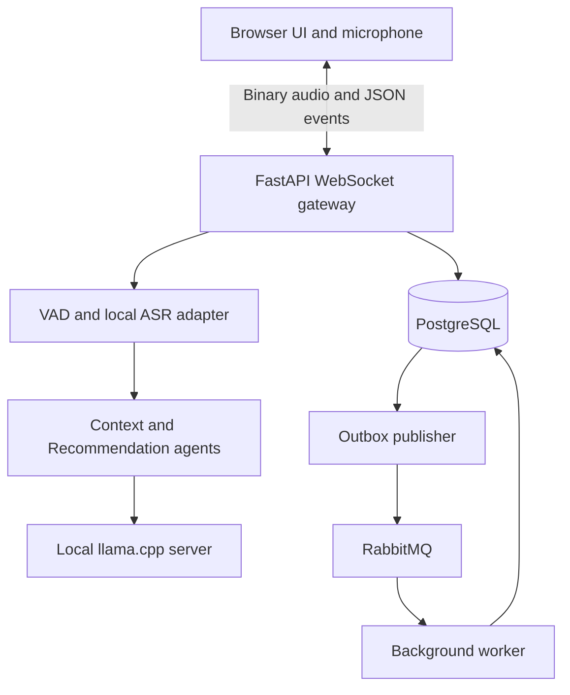
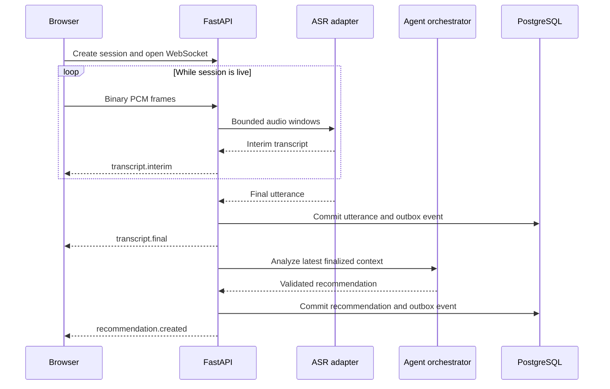
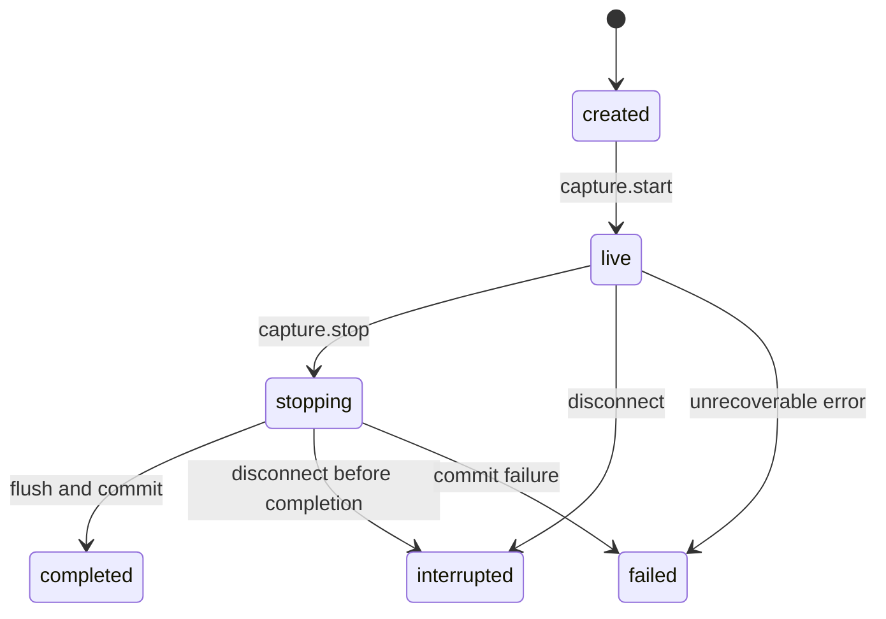

# Live AI Copilot System Architecture

**Status:** Proposed MVP architecture\
**Version:** 1.0\
**Date:** 18 November 2026\
**Related document:** [Live AI Copilot PRD](Live_AI_Copilot_PRD.md)\
**Delivery constraint:** 5–7 evenings, local deployment and local inference

## 1. Summary

Live AI Copilot is a single-user, locally deployed application that listens to a support-style conversation, displays an incremental transcript, and suggests actions grounded in a small FAQ. The primary engineering goal is to demonstrate a responsive asynchronous Python backend with explicit service boundaries, persisted state, reliable event delivery, and observable failure behavior.

The MVP uses **one FastAPI application**, **one background worker**, PostgreSQL, RabbitMQ, and a locally running LLM server. The Context Agent and Recommendation Agent are Python modules within the application, not independently deployed microservices. This keeps the system implementable in one week while preserving clear contracts that could support future service extraction.

### Architectural decisions

1. **Keep the audio hot path off RabbitMQ.** WebSocket audio, transcription, and recommendations run directly through the application so background queue delays do not affect conversational responsiveness.
2. **Persist authoritative state before emitting durable events.** PostgreSQL stores finalized utterances and recommendations; a small transactional outbox transfers associated events to RabbitMQ.
3. **Use at-least-once messaging with idempotent consumers.** Neither RabbitMQ delivery nor publish retries imply exactly-once execution. Database uniqueness constraints establish exactly-once *effects* for supported operations.
4. **Run inference locally, but keep adapters replaceable.** The ASR adapter targets `faster-whisper`; the LLM adapter targets llama.cpp. Models and performance settings are chosen after benchmarking the development machine.
5. **Optimize for one real session.** The MVP has one active operator, bounded in-process queues, a short seeded knowledge base, and no distributed orchestration platform.

## 2. System Context



The arrows show ownership and communication, not a strict synchronous chain. The gateway coordinates ASR and agents, sends updates to the browser, and writes finalized records to PostgreSQL. The outbox publisher and background worker are independent of the audio receive loop.

### Runtime components

| Component | Responsibility | Runtime and boundary |
| --- | --- | --- |
| Browser UI | Microphone permission, audio capture, transcript and recommendation display, session controls | Static HTML, JavaScript, `AudioWorklet` |
| FastAPI app | HTTP API, WebSocket session lifecycle, async queues, orchestration, persistence | One Python process for MVP |
| ASR adapter | Voice activity detection, utterance windows, interim and final transcript results | `faster-whisper` behind a Python interface; blocking inference off the event loop |
| Agent orchestrator | Invoke Context Agent, retrieve FAQ evidence, invoke Recommendation Agent, validate output | In-process Python modules with an async llama.cpp client |
| PostgreSQL | Sessions, finalized utterances, recommendations, outbox, processed events, summaries | Docker Compose service |
| RabbitMQ | Durable delivery of completed domain events and post-session tasks | Docker Compose service |
| Background worker | Handle completed-session events, build optional session summary, record idempotent results | Separate Python process |
| llama.cpp | Local inference for both agent roles | Native host process for the initial MVP |

## 3. Real-Time Processing

### Audio transport and utterance boundaries

- The browser captures mono audio and converts it to a configured format, initially **16 kHz signed 16-bit PCM**. It sends binary WebSocket frames, initially around **100 ms per frame**. Actual microphone sampling rates are converted by the client; the server validates format and frame size.
- The WebSocket also accepts JSON control messages and sends JSON status, transcript, and recommendation events. All JSON envelopes carry `schema_version`, `session_id`, `event_id`, and `sequence` where applicable.
- The API maintains a bounded `asyncio.Queue` per active session. A receive coroutine must never run synchronous model inference. A dedicated coroutine consumes audio and dispatches work to a controlled inference executor.
- A local voice activity detector groups speech into utterances. Initial tunables: **700 ms silence threshold**, **3 seconds interim-window target**, and **12 seconds maximum utterance**. These are starting values, not validated defaults for every language or machine.
- Interim transcription may revise earlier text. Only a finalized utterance has a stable `utterance_id` and is authoritative. The UI replaces interim text instead of appending duplicate words.
- When ASR capacity falls behind, first skip superseded *interim inference requests*. Never silently discard source audio. If the bounded source-audio buffer remains full, signal `session.overloaded` and stop accepting more audio until recovered or terminate the session with an explicit error.

### Session and inference sequence



For the MVP, the Context Agent and Recommendation Agent execute sequentially. They can use separate prompts and typed results against the same local model. This is intentionally a **multi-role orchestration pattern**, not a claim of autonomous distributed agents.

### Agent responsibilities

1. **Context Agent:** receives a bounded window of finalized utterances and returns `issue`, `intent`, and `confidence` or `insufficient_context`. No tool invocation is required.
2. **FAQ lookup:** performs deterministic matching against a small versioned JSON knowledge base. It returns candidate FAQ IDs and short evidence snippets; a vector database is unnecessary for the MVP.
3. **Recommendation Agent:** receives the structured context and FAQ candidates, then returns `action`, `rationale`, and `faq_ids`. If the evidence is weak, it must say that the cause is unconfirmed and suggest a diagnostic check rather than inventing facts.

Use Pydantic models to validate agent JSON before saving or displaying it. The orchestrator applies timeouts, cancels or discards results superseded by newer session context, and limits concurrent model requests. Store prompt versions alongside recommendation metadata for replay and debugging.

## 4. Public Contracts

### HTTP and WebSocket endpoints

| Endpoint                            | Purpose                    | MVP behavior                                                 |
|-------------------------------------|----------------------------|--------------------------------------------------------------|
| `POST /api/sessions`                | Create a session           | Returns `session_id` and `status=created`                    |
| `GET /api/sessions/{id}`            | Read session state         | Includes status, timestamps, and summary availability        |
| `GET /api/sessions/{id}/transcript` | Read finalized records     | Ordered utterances and associated recommendations            |
| `GET /api/sessions/{id}/report`     | Read session report        | Returns session report                                       |
| `WS /ws/sessions/{id}`              | Live control and streaming | Binary PCM from client; JSON events in both directions       |
| `GET /healthz`                      | Local liveness             | Lightweight application liveness response                    |
| `GET /readyz`                       | Dependency readiness       | Reports PostgreSQL, RabbitMQ, and model readiness separately |
| `GET /metrics`                      | Prometheus exposition      | Optional MVP instrumentation                                 |

The client sends `capture.start` and `capture.stop` control messages. The WebSocket session ID comes from the URL. A client disconnect transitions the session to `interrupted` after a best-effort flush; it is not silently marked `completed`. Automatic resumption of a live stream is out of scope; finalized records remain queryable.

### JSON event example

```json
{
  "schema_version": 1,
  "event_id": "d60e6f4e-2f6f-47f6-852a-894aac3f9b82",
  "event_type": "transcript.final",
  "session_id": "9091cdd0-474b-48fb-b37e-e827a5a49c90",
  "sequence": 12,
  "occurred_at": "2026-11-18T08:00:00Z",
  "correlation_id": "9091cdd0-474b-48fb-b37e-e827a5a49c90",
  "payload": {
    "utterance_id": "63b54e4d-95f1-49a5-825e-659d8d50fc2a",
    "start_ms": 8100,
    "end_ms": 12700,
    "text": "Customers are receiving duplicate API notifications."
  }
}
```

The schema example illustrates a finalized utterance; UUIDs and timestamps are placeholders. Client-side WebSocket events and broker messages share a versioned envelope, but **`transcript.interim` is WebSocket-only** and is neither written as an authoritative transcript nor sent through RabbitMQ.

### State transitions



All timestamps use UTC; transcript timing offsets use milliseconds since session audio start. Messages are ordered per WebSocket connection; `sequence` allows the UI and tests to detect duplicate or superseded logical events.

## 5. Data Model

| Table | Key fields | Constraints and ownership |
| --- | --- | --- |
| `sessions` | `id`, `status`, `started_at`, `ended_at`, `asr_model`, `llm_model` | Created and finalized by API |
| `utterances` | `id`, `session_id`, `sequence`, `start_ms`, `end_ms`, `text`, `created_at` | `UNIQUE(session_id, sequence)`; only finalized text |
| `recommendations` | `id`, `session_id`, `utterance_id`, `context_version`, `action`, `rationale`, `faq_ids`, `prompt_version` | Idempotency key derived from utterance and context version |
| `outbox_events` | `event_id`, `type`, `payload`, `created_at`, `published_at`, `attempts` | Created in the same transaction as the authoritative record |
| `processed_events` | `consumer_name`, `event_id`, `processed_at` | Composite primary key prevents duplicate consumer side effects |
| `session_summaries` | `session_id`, `summary`, `created_at` | One completed summary per session; produced by worker |

SQLAlchemy `AsyncSession` instances must be scoped to an individual request or task; concurrent coroutines must not share a mutable session. Use Alembic migrations for all schema changes. The API writes finalized transcripts directly, so a stopped background worker does not prevent a user from retrieving a completed transcript.

## 6. Reliable Background Processing

The background path is **PostgreSQL outbox → RabbitMQ → worker → PostgreSQL**.

1. The API commits the finalized utterance, recommendation, or session status together with an `outbox_events` record.
2. An outbox publisher, initially a supervised background task in the API process, polls unpublished rows, sends persistent messages to a durable RabbitMQ queue, and waits for publisher confirmation before setting `published_at`. On API restart, it resumes unpublished rows.
3. The consumer handles `session.completed` by creating an optional post-session summary. It records `(consumer_name, event_id)` in the same database transaction as the summary update.
4. Only after the database transaction commits does the consumer acknowledge the RabbitMQ delivery. Retrying an event is safe because the processed-event key and summary uniqueness constraint prevent duplicate effects.
5. Transient errors trigger bounded retries with backoff. After repeated failures, move the message to a dead-letter queue and surface an error counter; do not retry indefinitely in a tight loop.

Initial durable event types are `transcript.final`, `recommendation.created`, and `session.completed`. The worker need not perform expensive work for every transcript event; it can record basic metrics, while summary generation is triggered once when the session completes. The exact broker routing keys and queue names are implementation details, versioned in configuration.

**Reliability boundary:** a confirmed broker publish can still be followed by an application crash before `published_at` is committed. The publisher may send the event again. At-least-once delivery plus consumer idempotency is therefore the intended guarantee. The system does not claim end-to-end exactly-once message delivery.

## 7. Failure Handling and Backpressure

| Failure | Required observable behavior | Recovery mechanism |
| --- | --- | --- |
| Browser loses microphone permission | UI displays a clear error; session does not enter an unsupported live state | Operator retries after granting permission |
| Audio queue exceeds bound | UI shows `session.overloaded`; source audio is not silently dropped | Pause capture or fail the session explicitly |
| ASR inference fails or times out | Live connection remains responsive; the affected utterance is flagged | Retry a bounded number of times; avoid claiming a final transcript |
| LLM times out or returns invalid JSON | Final transcript remains available; recommendations show a nonfabricated fallback | Timeout, validation, and limited retry |
| RabbitMQ consumer stops | Live transcript and recommendations continue; durable queue depth increases | Restart worker; drain pending events idempotently |
| RabbitMQ broker is unavailable | API can commit final records and outbox entries; outbox backlog is visible | Publisher retries when broker returns |
| PostgreSQL write fails | UI reports persistence failure; no success acknowledgement for an uncommitted final record | Abort or fail session, preserve diagnostic logs |
| Duplicate RabbitMQ delivery | One processed-event record and one summary result | Unique constraints and transaction-bound ack |

The audio queue has a finite capacity, initially equivalent to roughly three seconds of frames. Inference work has bounded concurrency; interim jobs can be superseded, but committed final transcript events must never be overwritten by interim results. Client display updates use monotonically increasing sequence numbers.

## 8. Observability and Performance

Minimum structured log fields are `timestamp`, `level`, `event`, `session_id`, `correlation_id`, `utterance_id` when present, and duration/error metadata. Do not log raw audio or full transcript text by default.

| Metric | Type | Why it matters |
| --- | --- | --- |
| `live_sessions` | Gauge | Confirm the one-session concurrency budget |
| `audio_buffer_seconds` | Gauge | Detect backpressure before overload |
| `asr_finalization_seconds` | Histogram | Speech-end to authoritative transcript latency |
| `recommendation_seconds` | Histogram | Final transcript to user-visible action latency |
| `llm_requests_total` | Counter | Success, timeout, and validation failure by outcome |
| `outbox_pending_events` | Gauge | Broker publication backlog |
| `worker_events_total` | Counter | Processed, duplicate, retried, and failed outcomes |
| `ws_disconnects_total` | Counter | Unexpected session interruptions |

The PRD's provisional targets are **p95 under 5 seconds** from utterance end to finalized transcript and **p95 under 10 seconds** from finalized transcript to recommendation. Measure both on the actual development machine; record CPU/GPU, RAM/VRAM, model sizes, sample count, and test fixture. Do not present these as achieved results before benchmarking.

## 9. Local Deployment

For the first implementation, Docker Compose runs **PostgreSQL and RabbitMQ**. The FastAPI app, background worker, ASR inference, and llama.cpp run on the host, where GPU/CPU access is simpler across Linux, Windows, and macOS. Full containerization of inference is optional and hardware-dependent.

Recommended local startup sequence:

1. Download the chosen ASR model and local LLM model once; document licenses and disk requirements.
2. Start infrastructure with `docker compose up -d postgres rabbitmq`.
3. Start the local llama.cpp service and verify the selected model works.
4. Apply database migrations.
5. Start the FastAPI app and the separate post-processing worker using documented development commands.
6. Open the app on `http://localhost:8000`; allow microphone access and run a short scripted conversation.

All credentials and configuration use `.env` variables with a checked-in `.env.example`. Do not commit downloaded models, secrets, raw audio, or session databases. Bind exposed service ports to localhost for the MVP. Use seeded FAQ and prerecorded demo audio that contain no real customer information.

### Proposed repository layout

```text
live-ai-copilot/
├── app/
│   ├── api/                 # HTTP routes and WebSocket session handler
│   ├── audio/               # Frame validation, VAD, ASR adapter
│   ├── agents/              # Context and Recommendation agents
│   ├── services/            # Session orchestration and result validation
│   ├── domain/              # Typed contracts, enums, domain models
│   ├── persistence/         # SQLAlchemy models, repositories, outbox
│   └── messaging/           # RabbitMQ publisher and consumer contracts
├── worker/                  # Background consumer entrypoint
├── ui/                     # Static UI and AudioWorklet
├── knowledge/faq.json       # Small versioned support knowledge base
├── alembic/                 # Schema migrations
├── tests/unit/
├── tests/integration/
├── tests/fixtures/          # Synthetic or consented demo audio
├── docker-compose.yml
├── .env.example
├── README.md
├── Live_AI_Copilot_PRD.md
└── ARCHITECTURE.md
```

## 10. Verification Plan

**Unit tests**

- Chunk and utterance assembly handles silence, overlap, and repeated interim results.
- Domain validators reject malformed agent responses; a missing FAQ match yields a safe fallback.
- Session state transitions reject invalid operations and preserve monotonic event sequence.

**Integration tests**

- WebSocket test streams a deterministic PCM fixture, receives interim/final events, and ends cleanly.
- PostgreSQL persists one finalized utterance for duplicate input event IDs.
- Transactional outbox rows survive publisher restarts; duplicate RabbitMQ deliveries create one summary.
- Stopping the consumer does not interrupt live transcription; queue drains after it restarts.
- ASR and LLM failures return user-visible status without freezing the socket.

**Demo acceptance**

1. The operator starts a session and speaks about duplicate API notifications.
2. The browser shows interim transcript text, then one stable final utterance.
3. A grounded recommendation appears with an FAQ ID or an explicit uncertainty statement.
4. The operator ends the session; the final transcript is retrievable over HTTP.
5. The worker is stopped and restarted; pending events are processed without duplicate summaries.
6. The screencast shows measured timings, a passing test, and the source architecture in under four minutes.

## 11. Tradeoffs and Deferred Work

| Decision | Why it is right for this MVP | Deferred alternative |
| --- | --- | --- |
| One API process with in-process agents | Minimizes deployment friction while keeping typed module boundaries | Extract independent agent or ASR services after proving need |
| Chunk-based ASR | Easier to build with local models in a week; interim results are best-effort | Low-latency continuous ASR or dedicated streaming engine |
| Fixed FAQ, no vector database | Makes grounding testable and deterministic | Retrieval with embeddings and citations |
| Native inference and containerized infrastructure | Avoids early GPU/container portability problems | Fully containerized local inference |
| Transactional outbox | Makes the worker-outage demonstration technically credible | Managed streaming platform or distributed workflow engine |
| One active session | Keeps latency tuning and resource behavior easy to measure | Multi-user admission control and horizontal scaling |

## 12. Open Decisions

- **Hardware:** operating system, CPU/GPU, RAM/VRAM, and acceptable local model sizes.
- **Language:** choose the primary spoken language and a matching ASR model.
- **Inference performance:** benchmark local ASR and llama.cpp before finalizing concurrency and latency limits.
- **Demo scope:** decide whether background session summary and the worker-restart scene are essential to the first screencast or a technical interview extension.

## References

- [FastAPI WebSockets](https://fastapi.tiangolo.com/advanced/websockets/)
- [Python asyncio queues](https://docs.python.org/3/library/asyncio-queue.html)
- [SQLAlchemy asyncio integration](https://docs.sqlalchemy.org/en/20/orm/extensions/asyncio.html)
- [RabbitMQ acknowledgements and publisher confirms](https://www.rabbitmq.com/docs/confirms)
- [RabbitMQ reliability guide](https://www.rabbitmq.com/docs/reliability)
- [faster-whisper project](https://github.com/SYSTRAN/faster-whisper)
- [llama.cpp server](https://github.com/ggml-org/llama.cpp/tree/master/tools/server)
